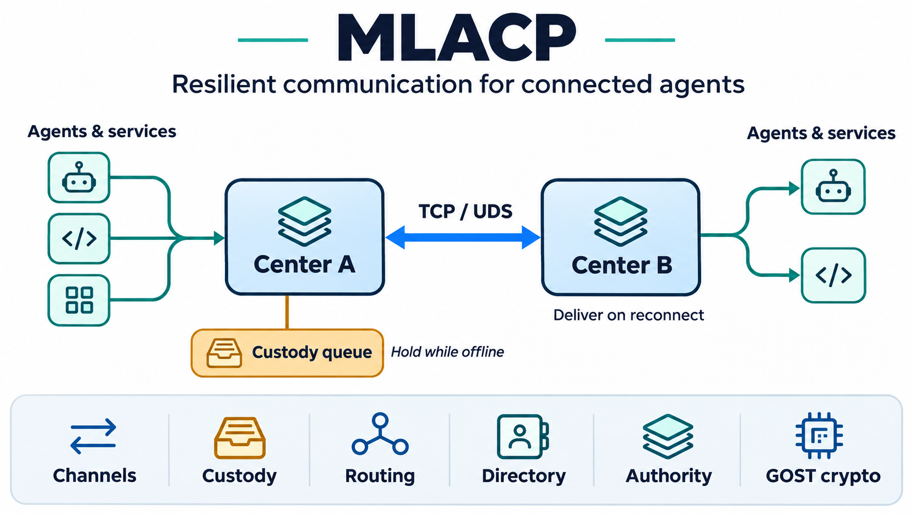

# MLACP

### Resilient communication for distributed agents

[](https://github.com/mrschneider/mlacp/actions/workflows/ci.yml)
[](https://github.com/mrschneider/mlacp/releases/latest)
[](pyproject.toml)
[](LICENSE)

**Connect agents across services, organizations, and intermittent networks—with explicit routing, custody, and delegated authority.**

MLACP, the **Multi-Layered Agentic Communication Protocol**, gives distributed
agents a common way to discover services, exchange messages, and transfer
responsibility for delivery. Its Python reference engine connects communication
centers over TCP and Unix domain sockets; an optional Rust backend accelerates
GOST cryptography.

[Get started](#get-started) · [How it works](#how-it-works) · [Technical reference](docs/technical-reference.md) · [Releases](https://github.com/mrschneider/mlacp/releases)

<p align="center">
  
</p>

## Keep agents connected as your system grows

A multi-agent system needs more than a successful API call. Services move,
connections drop, and permissions change. MLACP makes those communication
concerns explicit, with a layered protocol and independently usable components.

| Your requirement | What MLACP provides |
|---|---|
| Reach services across multiple centers | Hierarchical service discovery and weighted routing across a communications grid. |
| Handle services that go offline | Bounded, in-memory custody with sequence-ordered release on reconnect and explicit transfer acknowledgements. |
| Delegate access across teams or agents | Capability chains that narrow permissions at each delegation and cascade revocation to descendants. |
| Protect traffic between centers | Optional GOST link encryption, VKO key agreement, and manual epoch re-keying. |
| Integrate different runtimes | A closed JSON wire vocabulary, Python reference implementation, and Node.js interoperability examples. |
| Keep resource use predictable | Bounded connection workers, reusable peer connections, frame limits, and configurable event-history retention. |

## Where it fits

- **Distributed agent platforms:** connect agents and services hosted behind multiple communication centers.
- **Edge and intermittent connectivity:** hold messages during a service's offline window and transfer custody when it returns.
- **Federated service networks:** combine hierarchical discovery, scoped delegation, and cross-center routing.
- **Protocol research and integration:** use readable Python contracts, standards vectors, and executable examples to evaluate behavior.

MLACP is an open-source protocol and reference engine. Teams adopting it for a
production service should plan persistence, operational monitoring, and peer
identity verification around their deployment requirements. Custody and event
histories in the reference engine are in memory.

## How it works

1. **Register and discover.** Agents bind services to hierarchical addresses such as `mlacp:acme/west/center-a/orders`.
2. **Route the message.** A center resolves the destination and delivers locally or forwards toward another center over TCP or UDS.
3. **Transfer custody when needed.** A relay holds bundles for an offline addressee. On reconnect, it releases them in sequence and retains responsibility until acknowledgement.
4. **Control authority and link protection.** Capability chains model scoped delegation; configured link keys or a VKO handshake enable encrypted center-to-center traffic.

The six layers can be explored separately or through `CenterNode`, the reference
participant that brings them together.

| Layer | Responsibility | Implementation |
|---|---|---|
| Channels | Transport and framing | `mlacp_engine.channels` |
| Custody | Offline retention and acknowledged transfer | `mlacp_core.custody` |
| Communications grid | Weighted routing and topology updates | `mlacp_core.grid` |
| Directory | Hierarchical registration and lookup | `mlacp_core.directory` |
| Authority | Scoped delegation and cascading revocation | `mlacp_core.authority` |
| Cryptography | GOST primitives, secure frames, and key agreement | `mlacp_core.gost`, `mlacp_core.gost_ec` |

Explore the [interactive architecture document](docs/architecture.html) by opening
it locally in a browser, or read the [full technical reference](docs/technical-reference.md).

## Get started

Requires **Python 3.10+**. The Python implementation works without the optional
native backend.

```sh
git clone https://github.com/mrschneider/mlacp.git
cd mlacp
python -m venv .venv
source .venv/bin/activate  # Windows PowerShell: .venv\Scripts\Activate.ps1
python -m pip install -e .
```

### Try offline custody

This small example holds a bundle for an offline service, releases it when the
service returns, and acknowledges the custody transfer.

```python
from mlacp_core import Bundle, CustodyRelay

relay = CustodyRelay(capacity=256)
destination = "mlacp:acme/west/center-b/orders"

relay.accept(Bundle(
    bundle_id="order-001",
    addressee=destination,
    ttl=4,  # contact windows, not wall-clock seconds
    body={"order_id": "A-1042", "action": "process"},
    origin="mlacp:acme/east/center-a/dispatcher",
    seq=1,
))

# The destination reconnects: release its bundles in sequence order.
for bundle in relay.contact(destination):
    print(bundle.body)
    relay.acknowledge(bundle.bundle_id)
```

### Run the connected examples

With **Node.js 18+** installed, run these from the repository root:

```sh
# Node.js client ↔ Python center: registration, delivery, custody, refusals
python experiments/run_e2e.py

# Two centers: cross-center forwarding, custody acknowledgements, and UDS
python experiments/run_federation.py
```

See [the cross-language client](experiments/client.js) and
[the federation driver](experiments/run_federation.py) for integration examples.

### Add native cryptography

Platform wheels for the optional `mlacp_gost` backend are available on the
[GitHub releases page](https://github.com/mrschneider/mlacp/releases/latest).
Download a wheel matching your platform, then install it with
`python -m pip install /path/to/downloaded.whl`.

MLACP selects the native backend automatically when installed. Set
`MLACP_PURE=1` to use the Python reference. Both paths are checked against the
same cryptographic conformance vectors; implementation details and platform
coverage are in the [technical reference](docs/technical-reference.md#performance--native-backend).

## Performance you can inspect

The engine uses indexed authority, directory, and custody state; heap-based
weighted routing; reusable outbound connections; and owned native crypto
contexts. The goal is efficient communication with explicit resource lifetimes.

Local development measurements from the v0.3.0 work include:

| Workload | Before | After |
|---|---:|---:|
| Authorize a holder among 10,000 grants | 223 µs | 0.53 µs |
| Directory lookup among 10,000 entries | 411 µs | 1.98 µs |
| Contact an absent addressee among 10,000 bundles | 383 µs | 0.68 µs |
| Sequential loopback exchange, fresh connection vs. pooled | 465 µs | 43 µs |

These are local measurements for specific workloads, not production capacity
guarantees. The [benchmark report](docs/benchmarks.md) describes methodology,
limitations, and the corrected harness.

A native-backend run of the same harness on the v0.3.1 tree
(`c3b23b8`, Rust MGM/Streebog with the RFC 6072-2 tag fix) produced:

| Workload | v0.3.1 (native) |
|---|---:|
| `secure_encrypt` 2 KB | 173 µs/call |
| `context.encrypt` 2 KB | 172 µs/call |
| `secure_decrypt` 2 KB | 173 µs/call |
| `context.decrypt` 2 KB | 187 µs/call |
| `ctr_encrypt` 2 KB | 28.6 µs/call |
| `streebog_256` 64 KB | 15.75 ms/call |
| `streebog_512` 64 KB | 16.07 ms/call |
| VKO-512 symmetric agreement (two-party) | 67.9 ms/call |
| Loopback exchange, 2,000 envelopes | 21.9 µs/frame (≈45,600 frames/s) |

Each crypto row is three runs of 20 timed calls; the envelope row verifies
2,000/2,000 deliveries. Values are single-machine local measurements, not
capacity guarantees, and the VKO row includes both peer operations.

```sh
python experiments/bench.py --iterations 20 --node-frames 2000
```

## Validation and deployment considerations

The repository includes per-layer tests, cryptographic standards vectors,
cross-language messaging examples, and a two-center federation experiment.
Kuznyechik, MGM, Streebog, and VKO are checked against their relevant RFC vectors;
the [technical reference](docs/technical-reference.md#verified-results) records
coverage and convention details.

Before deploying, account for these implementation properties:

- **Persistence:** custody, journals, and authority history are in memory; event-history retention is configurable and is not a durable audit log.
- **Link security:** traffic is plaintext until a link key is configured or a handshake establishes one. Key agreement needs a deployment-specific peer-authentication policy; re-keying is manual.
- **Side channels:** the default table-driven crypto paths use secret-indexed memory. A table-free native Kuznyechik block primitive exists, but does not make the default secure-frame path constant-time.
- **Delivery semantics:** acknowledgements represent custody transfer. Ambiguous failed exchanges are not automatically retried; applications should define recovery and deduplication behavior.

See [resource controls](docs/technical-reference.md#performance-and-resource-controls)
for connection limits, deadlines, shutdown, and history retention.

## Documentation and project background

- [Technical reference](docs/technical-reference.md): protocol vocabulary, crypto conformance, implementation details, and resource controls.
- [Architecture](docs/architecture.html): self-contained visual guide; open locally in a browser.
- [Benchmarks](docs/benchmarks.md): reproducible measurements and their limits.
- [Design origins](docs/research/soviet-communications-architectures.md): the historical network architectures, relay systems, directory models, and cryptographic standards that informed the six layers.

MLACP translates those architectural ideas into an agent communication protocol,
with executable contracts and a modern Python/Rust implementation.

## Contribute and license

Report bugs and propose integrations through
[GitHub Issues](https://github.com/mrschneider/mlacp/issues), or submit a pull
request with a focused example and relevant tests.

```sh
python -m pip install pytest pycryptodome gostcrypto
python -m pytest tests/ -q
MLACP_PURE=1 python -m pytest tests/ -q
```

MLACP is available under the [MIT License](LICENSE).
